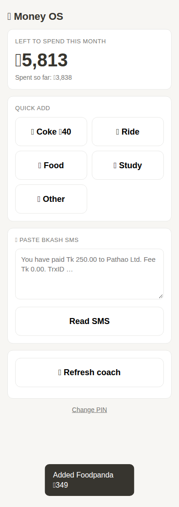

# 💰 Student OS: Money

**A Money section for your Notion Student OS.** One command (`npm run setup`) builds 6 linked Notion databases with formulas, rollups and sample data, so a student can see at a glance **where their money goes** and **how much they actually have left to spend this month**.

Built for the Cognition hackathon "Build a Smarter Student OS Using Devin", using **Devin Chat** as the primary development tool.

## What it does / the problem

A typical student in Dhaka lives on pocket money, tutoring income and the occasional cash gift. The money disappears through small things: a ৳40 Coke here, a ৳250 Uber there, a Spotify renewal nobody remembers. Without seeing those together, there's no way to tell how much money is actually **disposable**.

Student OS: Money answers two questions on one Notion page:

1. **Where is my money going?** Spending by category this month, ranked (🥤 Snacks vs 🚗 Rides vs 📺 Subscriptions …).
2. **How much do I have left to spend this month?** `Left to Spend = Income This Month − Spent This Month`, computed live in Notion.

Plus per-category budgets ("Budget Left"), subscription renewal tracking, and savings goals with progress bars.

With the sample data, the dashboard immediately tells a story: **rides are eating your money** (৳1,790 this month, ৳290 over budget), and you have **৳6,202** left to spend.

## How it uses Notion Student OS

It extends the Student OS from the Notion Campus Leaders workshop (Courses, Assignments, Notes, Tasks and a dashboard page) with a **💰 Money** page created inside your Student OS page. It uses the same Notion building blocks: databases, relations, rollups, formulas, views, charts and buttons.

| Database | What it holds | Key properties |
| --- | --- | --- |
| 👛 **Wallet** | One row, "My Wallet": the hub for monthly totals | Rollups `Spent This Month (৳)`, `Income This Month (৳)`, `Subscriptions Monthly (৳)`; formula **`Left to Spend (৳)`** |
| 🏷️ **Categories** | 🥤 Snacks & Drinks, 🚗 Rides, 📺 Subscriptions, 🍛 Food, 📚 Study, 🎁 Other | `Monthly Budget (৳)`, rollup `Spent This Month (৳)`, formula `Budget Left (৳)` |
| 💸 **Expenses** | Every purchase | `Amount (৳)`, `Date`, `Category`, `Wallet`, `Paid With` (Cash/bKash/Card), formulas `This Month`, `Amount This Month`; optional `Course` link |
| 💵 **Income** | Pocket money, tuition, gifts | `Amount (৳)`, `Date`, `Source`, `Wallet`, `This Month`, `Amount This Month` |
| 📺 **Subscriptions** | Renewals to remember | `Price (৳)`, `Billing` (Monthly/Yearly), `Next Renewal`, `Active`, formula `Monthly Cost` |
| 🎯 **Goals** | Savings targets | `Target (৳)`, `Saved (৳)`, `Deadline`, formula `Progress` (0–1) |

**The "Wallet hub" trick:** Notion formulas can't add up values across databases. So every Expense, Income and Subscription is linked to a single "My Wallet" row through a **two-way relation**, and rollups on that row add up the month's totals. "This month" is a formula on each row (`Amount This Month` is 0 for older entries), so last month's spending never leaks into the number.

**Subscriptions are counted once:** when a subscription is actually charged, it's logged as an Expense in 📺 Subscriptions, so it shows up in the chart next to Cokes and rides. The Subscriptions database tracks renewals and reminders and is *not* subtracted again.

**Optional Courses link:** set `NOTION_COURSES_DB_ID` and expenses get a one-way `Course` relation to your existing Student OS Courses database (e.g. printing or a textbook for CSE220). Your Courses database isn't modified.

## 🧠 Smart add-ons: Coach, phone quick-add, bKash SMS

The Notion section organises money; the add-ons **decide** things and make logging effortless.



### 1. Money Coach (`npm run coach`)
Reads this month's Expenses, the Wallet totals and your Goals, then writes a **🧠 Money Coach · 21 Nov 2026** page under 💰 Money (the first insight as a callout, the rest as bullets). Rules, not AI: free, no API key, the same answer every time.

Sample output for the seeded month:
- 🚗 Rides is your top drain: 47% of spending (৳1,790 of ৳3,798).
- 🥤 Snacks & Drinks: 6 buys so far, ৳270. Small, but it adds up.
- Your average ride costs ৳224. Skipping 2 rides a week saves about ৳1,924/month.
- 🎯 Emergency fund: ৳7,500 to go. At ৳6,202/month that's 1.2 months; with the cut it's 0.9 months, 1 week sooner.
- 📈 At this pace you'll spend ৳5,426 this month: on track with your ৳10,000 income.

Edge cases: no expenses → "No spending logged this month yet."; Left to Spend ≤ 0 → "At current spending you won't reach …" (no divide-by-zero); finished or missing goals are skipped.

### 2. Quick-add web app (phone)
A mobile page with big buttons: **🥤 Coke ৳40** (one tap), plus 🚗 Ride, 🍛 Food, 📚 Study and 🎁 Other (number keypad for the amount). It shows **Left to Spend** from the Wallet, and a **🧠 Refresh coach** button runs the coach from your phone. Each tap creates an Expense in Notion (Date today, Category and Wallet set), so the dashboard updates live.

- Static `public/index.html` (vanilla JS) + Vercel serverless functions in `api/` (`/api/add`, `/api/summary`, `/api/coach`).
- **The Notion token never reaches the browser**; it lives in server env vars.
- **PIN gate:** every `api/*` call needs header `x-pin` = `APP_PIN`, otherwise 401 and nothing is written. The page asks for the PIN once and remembers it.
- **Live:** <https://student-os-money.vercel.app> (PIN-protected; PIN not published).

### 3. bKash SMS paste
Paste a bKash SMS → **Read SMS** → an editable preview (amount, name = merchant, guessed category) → **Save to Notion** with Paid With = bKash. Nothing is saved without your confirmation; an SMS it can't read shows *"Couldn't read this SMS — enter it manually"*. "Received" SMS are recognised and pointed to the Income database.

- `parseSms(text)` → `{amount, merchant, trxId, kind}` handles `Tk` / `৳` / `BDT`, comma amounts (`Tk 1,250.00` → 1250), "You have paid", "Payment", "Send Money", "Cash Out" and "received".
- `guessCategory(merchant)`: Pathao/Uber/Obhai/Shohoz → 🚗 Rides; Foodpanda/Pathao Food/KFC/cafe → 🍛 Food; Spotify/Netflix/YouTube/Google/ChatGPT → 📺 Subscriptions; else 🎁 Other.
- Parsing runs in the browser (`public/sms.js` is a tested copy of `src/sms.js`). Fixtures live in `test/fixtures/sms.txt`.

### Add-on setup
1. Get the IDs of your existing Money section (setup also prints them at the end):
   ```bash
   npm run ids     # prints EXPENSES_DS_ID, CATEGORIES_DS_ID, GOALS_DS_ID, WALLET_PAGE_ID, MONEY_PAGE_ID
   ```
   Paste them into `.env` and add `APP_PIN=<your pin>`.
2. Try it locally: `npm run coach`, or `npm run dev` → <http://localhost:3000>.
3. **Deploy to Vercel (free):** import the GitHub repo at <https://vercel.com/new> (framework preset: *Other*, no build command), or run `npx vercel --prod`. In **Settings → Environment Variables**, add `NOTION_TOKEN`, `APP_PIN`, `EXPENSES_DS_ID`, `CATEGORIES_DS_ID`, `GOALS_DS_ID`, `WALLET_PAGE_ID`, `MONEY_PAGE_ID`, then redeploy. Open the URL on your phone and tap 🥤.

## How I used Devin Chat

Design brainstorming (the problem, data model and approach) was done with **Claude**, producing a written spec and a task-by-task plan, both in [`docs/superpowers/`](docs/superpowers). **Devin** then built the whole project from the chat:

**Prompts used:**
1. *"How do I integrate Notion here?"* Devin connected to my workspace through the Notion MCP server and explained the two integration layers: Devin ↔ Notion, and the app ↔ Notion API.
2. *"Create an empty public GitHub repo, for example `student-os-money`. Read `docs/superpowers/specs/2026-11-21-student-money-os-design.md` and then execute `docs/superpowers/plans/2026-11-21-student-money-os.md` task by task, committing after each task. For Task 3, I'll give you my Notion token and page ID as secrets… If the Task 3 check fails, stop and tell me the exact error. Keep it simple; this is a 1.5-hour hackathon build."*

**What Devin built** (one commit per plan task, see the git history):
- **Task 1:** scaffold, `.env` config loading, and friendly Notion error messages (401 / 403 / 404 → plain-English fixes)
- **Task 2:** all Notion property and formula definitions in one place (`src/schema.js`), unit-tested
- **Task 3:** a feasibility check against real Notion (`npm run check`): does a rollup of a formula work across a two-way relation? → `Rollup OK: 40`
- **Task 4:** realistic, month-safe sample data (`src/seed.js`), tested for the 1st and the 30th of a month
- **Task 5:** `npm run setup`, run against my real workspace and verified (Left to Spend ৳6,202 = ৳10,000 − ৳3,798; Rides is the biggest category)
- **Task 6:** this README

3. *"Read `docs/superpowers/specs/2026-11-21-money-os-smart-addons-design.md`, then execute `docs/superpowers/plans/2026-11-21-money-os-smart-addons.md` task by task, committing after each. Tasks are in priority order; if time gets short, finish the current task, push, and stop. Use my existing Notion secrets, plus `APP_PIN` as a new secret. Keep it simple: this is a hackathon build due at 6 PM."*

**Add-ons Devin built** (again one commit per task):
- **Task 1:** `npm run ids` finds the existing Money section and prints the IDs the add-ons need
- **Task 2:** the Money Coach (`src/coach.js`), test-first, then run against the real workspace. Devin also caught an arithmetic slip in the plan's test (avg ৳200 × 2 × 4.3 is ৳1,720, not ৳3,440) and fixed the fixture
- **Task 3:** the PIN-gated quick-add app; verified that a 🥤 tap drops Left to Spend by ৳40 in Notion and that a missing PIN gives 401. It also worked around Notion rollups lagging a few seconds after a write
- **Task 4:** bKash SMS parsing (`src/sms.js`) with fixtures and an in-browser preview, verified end to end (row saved with Paid With = bKash)

Devin also handled the setup hiccups along the way. When I pasted the token into the page-ID secret, it told me the exact error, then waited until the page was shared with the integration before rerunning the check.

## Setup

Requirements: Node.js 20+

1. **Create a Notion integration:** <https://www.notion.so/my-integrations> → **New integration** (Internal). Under Capabilities, enable **Read**, **Update** and **Insert content**. Copy the **Internal Integration Secret**.
2. **Share your Student OS page** with it: open the page → **⋯ → Connections** → pick your integration. (Or: integration settings → **Access → Edit access** → select the page.)
3. **Configure and run:**
   ```bash
   git clone https://github.com/Yasout141516/student-os-money.git
   cd student-os-money
   cp .env.example .env      # fill in NOTION_TOKEN and NOTION_PARENT_PAGE_ID (32-char ID from the page URL)
   npm install
   npm run check             # optional: confirms rollups work in your workspace → "Rollup OK: 40"
   npm run setup             # builds 💰 Money with sample data; prints the page URL
   ```
   Use `npm run setup -- --no-sample` to create empty databases. Each run creates a fresh Money page.

If something's wrong, the script prints a one-line fix, e.g. *"Notion page not found. Share your Student OS page with the integration: ⋯ → Connections"*.

## Manual Notion steps (about 10 min)

The Notion API can't create charts, buttons, reminders or formula bar displays, so these are done by hand:

1. **Dashboard layout:** on the 💰 Money page, add a callout with a linked view of **Wallet** showing `Left to Spend (৳)`. Below it, add two columns: the chart (step 2) and an "Upcoming Renewals" linked view of Subscriptions sorted by Next Renewal.
2. **Chart:** Expenses → **+ Add view → Chart** (bar or donut). Group by **Category**, value = **Sum of Amount (৳)**, filter **This Month** is checked.
3. **Quick-add buttons:** insert a **Button** block "🥤 Coke ৳40" → *Add page to 💸 Expenses* with Name = Coke, Amount = 40, Category = 🥤 Snacks & Drinks, Date = today, Wallet = My Wallet. Add a second button, "🚗 Ride", that adds a ride expense (Category = 🚗 Rides, Wallet = My Wallet, Date = today) and opens the page so you can type the fare.
4. **Default templates:** on Expenses and Income, create a template with Wallet = My Wallet and Date = today, and set it as the default, so normal "New" entries are counted.
5. **Reminders:** on each subscription's **Next Renewal** date, add a reminder 1 day before. On Notion Education Plus, you can use a database automation instead.
6. **Views:** Subscriptions → add a **Calendar** view (by Next Renewal). Goals → add a **Gallery** view.
7. **Progress bars:** Goals → `Progress` property → **Show as: Bar** (also optional for Wallet's Left to Spend).

## Testing

```bash
npm test        # unit tests (node:test): config, errors, schema, seed, coach, PIN gate, SMS parsing
npm run check   # live check against your Notion workspace
```

The add-on tests cover: no expenses → one coach line; Left to Spend ≤ 0 → "won't reach" with no `Infinity`/`NaN`; `Tk 1,250.00` → 1250; an unreadable SMS → `kind: 'unknown'`, `amount: null`; and a wrong or missing PIN → 401 (`checkPin` is false when `APP_PIN` is unset).

The original tests cover the plan's review focus points: an expense with no date counts as ৳0 (not an error), a goal with Target 0 shows 0 progress (no divide-by-zero), sample dates stay within the current month whether you run it on the 1st or the 30th, and Rides is always the biggest category.

## Project structure

```
src/config.js       loads and validates .env
src/errors.js       plain-English Notion error messages
src/schema.js       property, formula, relation and rollup definitions
src/seed.js         sample data (month-safe dates)
src/notion.js       thin wrappers over @notionhq/client (Notion-Version 2025-09-03, data sources)
src/check-rollup.js npm run check (feasibility check, cleans up after itself)
src/setup.js        npm run setup (builds the Money section)
src/ids.js          finds/prints the add-on IDs (npm run ids)
src/coach.js        Money Coach rules + Notion read/write (npm run coach)
src/sms.js          bKash SMS parser + category guess (copied to public/sms.js)
api/                Vercel functions: add, summary, coach (+ _auth.js PIN gate)
public/index.html   mobile quick-add web app
dev-server.js       local stand-in for Vercel (npm run dev)
test/               node:test unit tests
docs/superpowers/   design spec and implementation plan
docs/screenshots/   screenshots
```

## Screenshots


_Add screenshots of the Money dashboard to `docs/screenshots/` after the manual steps._
